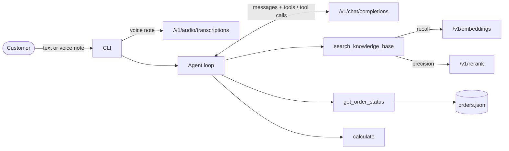
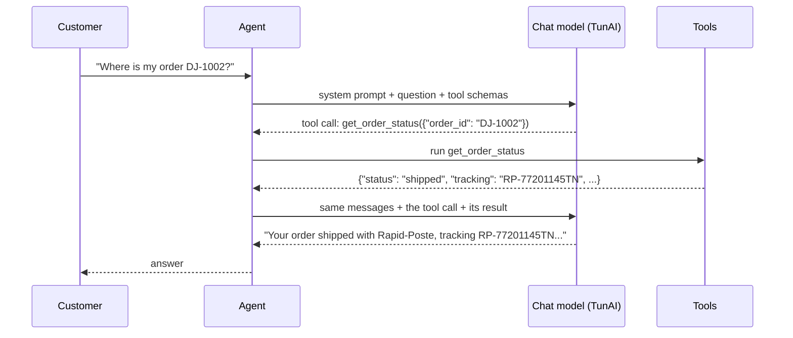

# Build an AI agent on TunAI

[](https://github.com/mahmoudsegni/tunai-agent-starter/actions/workflows/ci.yml)

A reference implementation of a **tool-calling agent** on the [TunAI](https://tunai.tn) API, with a step-by-step guide. It uses four TunAI endpoints: chat completions with function calling, embeddings, rerank and speech-to-text.

The sample agent is a customer-support assistant for **Dar Jasmin**, a fictional online shop selling Tunisian ceramics. It answers from the shop's policies with citations, looks up orders, computes amounts exactly, and accepts voice notes. It is small enough to read in one sitting, and structured the way you would build a real one.

```text
$ tunai-agent -v ask "Combien je paie la livraison pour 2 plats tajine à 38.5 vers Sousse ?"
  → search_knowledge_base({"query":"shipping fees delivery to Sousse ...","top_k":3})
  → calculate({"expression":"2 * 38.5 + 9"})
Tu paies 86 TND au total : 77 TND pour les 2 plats + 9 TND de livraison vers Sousse.
[shipping.md › Fees]

$ tunai-agent -v ask "My Guellala jar arrived broken, order #1002. What can I do?"
  → get_order_status({"order_id":"DJ-1002"})
  → search_knowledge_base({"query":"broken item arrived damaged returns refund replacement","top_k":3})
I can help, but there's a mismatch: order DJ-1002 is a shipped order for a Sejnane clay vase
plus 3 olive wood spoons. I don't see a Guellala jar in it. [...] Please confirm the correct
order number so I can help you properly.
```

<sub>Real runs on `gpt-5.4-mini`, lightly trimmed. Wording varies from run to run.</sub>

> TunAI is an AI gateway for Tunisia, paid in dinar. One API key reaches models from OpenAI, Anthropic, Google, DeepSeek, Mistral, Zhipu, MiniMax and leading open models, through an **OpenAI-compatible API**. If you have used the OpenAI SDK, you already know how to call it.

---

## Contents

1. [How it works](#how-it-works)
2. [Quickstart](#quickstart)
3. [Learn the endpoints, one step at a time](#learn-the-endpoints-one-step-at-a-time)
4. [Run the agent](#run-the-agent)
5. [The agent, piece by piece](#the-agent-piece-by-piece)
6. [Choosing models](#choosing-models)
7. [Make it yours](#make-it-yours)
8. [Production checklist](#production-checklist)
9. [Troubleshooting](#troubleshooting)
10. [Project layout](#project-layout)

---

## How it works



The model never runs anything itself. On each turn it either answers, or replies with **tool calls** (a function name and JSON arguments). The agent runs those functions, sends the results back, and asks again, until the model answers or the step budget runs out.



| TunAI endpoint | Used for | Default model | Key scope |
|---|---|---|---|
| `POST /v1/chat/completions` | The agent's reasoning and tool calls | `gpt-5.4-mini` | `chat` |
| `POST /v1/embeddings` | Indexing and searching the knowledge base | `text-embedding-3-small` | `embeddings` |
| `POST /v1/rerank` | Ordering search results by relevance | `Qwen/Qwen3-Reranker-4B` | `rerank` |
| `POST /v1/audio/transcriptions` | Voice notes to text | `openai/whisper-large-v3-turbo` | `audio` |
| `GET /v1/models` | Listing the models your key can use | | |

Base URL: `https://api.tunai.tn/v1`. Authentication: `Authorization: Bearer sk-tunai-...`. Request and response shapes, headers and error codes for each endpoint are in the **[API cheatsheet](docs/api-cheatsheet.md)**.

---

## Quickstart

You need Python 3.10+ and a TunAI account.

### 1. Create an API key

1. Sign in at **[console.tunai.tn](https://console.tunai.tn)** and accept the Terms of Service (the console asks once, before your first key).
2. Open **API keys** and create a key. For this project, you can restrict it to the `chat`, `embeddings`, `rerank` and `audio` scopes, and set a **monthly budget** and a **requests-per-minute** limit. A key with no scopes can call every endpoint.
3. Copy the key when it is shown (it starts with `sk-tunai-`) and store it somewhere safe. You will not see it again.
4. API usage is paid from your TunAI balance. Top it up in dinar from **Billing** if needed. The examples here cost a fraction of a dinar.

### 2. Install

```bash
git clone https://github.com/mahmoudsegni/tunai-agent-starter.git
cd tunai-agent-starter
python -m venv .venv && source .venv/bin/activate   # Windows: .venv\Scripts\activate
pip install -e ".[dev]"
```

### 3. Configure

```bash
cp .env.example .env
```

Open `.env` and paste your key after `TUNAI_API_KEY=`. `.env` is listed in `.gitignore`, so it is never committed. Then check that the key works:

```bash
tunai-agent models
```

You should see the list of model ids your key can use.

---

## Learn the endpoints, one step at a time

Each script in [`examples/`](examples) is short, self-contained and uses only the official `openai` SDK (plus `httpx` for rerank). Read them in order: together they are everything the agent does.

| Script | What it shows |
|---|---|
| [`01_first_request.py`](examples/01_first_request.py) | The OpenAI SDK pointed at TunAI: `base_url` and your key are the only changes. |
| [`02_streaming.py`](examples/02_streaming.py) | Streaming tokens with Server-Sent Events, and reading usage from the final chunk. |
| [`03_tool_call.py`](examples/03_tool_call.py) | **One tool call by hand.** The whole idea of an agent in 60 lines. |
| [`04_embeddings_and_rerank.py`](examples/04_embeddings_and_rerank.py) | Semantic search with embeddings, then a reranker to order the shortlist. |
| [`05_transcribe.py`](examples/05_transcribe.py) | Speech-to-text for voice notes in Arabic, French or English. |

```bash
python examples/01_first_request.py
python examples/03_tool_call.py
```

The tool-call round trip from step 3, as raw JSON:

```jsonc
// 1. You send the question and the tools
{"model": "gpt-5.4-mini",
 "messages": [{"role": "user", "content": "How much is delivery to Sfax?"}],
 "tools": [{"type": "function", "function": {"name": "shipping_fee", "parameters": {...}}}]}

// 2. The model answers with a tool call instead of text
{"role": "assistant", "content": null,
 "tool_calls": [{"id": "call_abc", "type": "function",
                 "function": {"name": "shipping_fee", "arguments": "{\"governorate\": \"Sfax\"}"}}]}

// 3. You run it and send back the model's turn AND your result, linked by tool_call_id
{"role": "tool", "tool_call_id": "call_abc", "content": "{\"governorate\": \"Sfax\", \"fee_tnd\": 9}"}

// 4. The model answers: "Delivery to Sfax costs 9 TND."
```

---

## Run the agent

```bash
# Interactive. -v shows each tool call, its result and the token usage.
tunai-agent -v chat

# One question
tunai-agent ask "Where is my order DJ-1005? I missed the courier."

# A voice note: transcribed with /v1/audio/transcriptions, then answered
tunai-agent ask --audio question.m4a --language ar

# Another model, a tighter step budget
tunai-agent ask --model claude-haiku-5-5 --max-steps 4 "Can I put a Nabeul plate in the dishwasher?"
```

Things to try: an order number in any format (`dj 1002`, `#1004`), a refund for a broken jar, a total with shipping, a question in Derja or French, a question the documents do not answer (it should say so, not invent a policy).

On the first run the agent embeds the knowledge base and caches the vectors in `.cache/`. Later runs reuse them until a document or the embedding model changes.

---

## The agent, piece by piece

The code lives in [`src/tunai_agent/`](src/tunai_agent). Each module does one job.

### 1. Tools: a schema the model reads, a function you run

[`tools/base.py`](src/tunai_agent/tools/base.py)

```python
Tool(
    name="get_order_status",
    description="Look up one order by its number (format DJ-1234)... Never guess order details: call this instead.",
    parameters={  # JSON Schema: what the model must send
        "type": "object",
        "properties": {"order_id": {"type": "string", "description": "e.g. 'DJ-1002'"}},
        "required": ["order_id"],
    },
    handler=get_order_status,  # your code
)
```

- The **description is part of the prompt**. It decides when the model calls the tool, so write it for the model: what it does, what it returns, when to use it.
- `ToolRegistry.execute` validates the model's arguments against the schema before running anything.
- **Every outcome goes back to the model as JSON, including failures.** An unknown tool, malformed arguments or an exception in your handler becomes `{"error": "..."}`. A model told "no order DJ-9999" can ask the customer to check the number; a model whose tool crashed the program can do nothing.

### 2. The loop: bounded, and always ends with an answer

[`agent.py`](src/tunai_agent/agent.py)

```python
for _ in range(self.max_steps):
    message = self._request(messages, result, tools=schemas)
    if not message.tool_calls:
        return self._finish(result, message.content)  # the answer
    messages.append(_assistant_message(message))  # the model's tool calls
    for call in message.tool_calls:  # parallel calls supported
        messages.append(self._run_tool(call, result))  # {"role": "tool", ...}

# Out of steps: tools stay declared but tool_choice="none" forces an answer
message = self._request(messages, result, tools=schemas, tool_choice="none")
```

- **`max_steps`** caps the model requests per turn. It is what stops a confused model from looping on your balance.
- When the budget runs out, the agent does not fail: one last request with `tool_choice="none"` makes the model answer with what it has, and `result.stopped_early` tells you it happened.
- **History** resends only the earlier user and assistant *text* turns, capped by `max_history_messages`. Earlier tool transcripts are dropped: the final answers already carry what the tools found, and replaying them would make every request bigger than the last.
- `on_event` receives `model_request`, `tool_call`, `tool_result` and `answer` events, for logs, traces or a UI. The CLI's `-v` flag is one subscriber.
- `AgentResult` returns the answer with the steps, every tool call with its duration, and token usage.

### 3. Retrieval: recall with embeddings, precision with a reranker

[`retrieval.py`](src/tunai_agent/retrieval.py)

1. Documents are split at their headings (and long sections at paragraph breaks). Each chunk keeps its heading, so it can be cited as `shipping.md › Fees`.
2. **Recall:** every chunk is embedded once with `/v1/embeddings`. A query is embedded and compared by cosine similarity, and the best 8 are kept. Cheap and fast, but similarity is a blunt measure of relevance.
3. **Precision:** `/v1/rerank` reads the query and each candidate *together* and scores how well the candidate answers it. Only the shortlist pays this cost.
4. If the reranker is disabled (`TUNAI_RERANK_MODEL=`) or fails, results keep the embedding order and a warning is logged. Search degrades instead of breaking.

The index is cached in `.cache/`, keyed on the embedding model and every chunk's text: you pay for embeddings once per change, not once per run.

### 4. The system prompt: concrete rules

[`prompts.py`](src/tunai_agent/prompts.py). Much of an agent's quality is decided here and in the tool descriptions, not in the loop. Prefer rules you could test ("never state an order detail the tool did not return", "use `calculate` for every amount", "cite the source") over aspirations ("be accurate").

### 5. Errors that tell you what to do

[`errors.py`](src/tunai_agent/errors.py). TunAI returns errors in OpenAI's envelope, `{"error": {"message", "type", "param", "code"}}`, so the OpenAI SDK raises its usual exceptions. `describe_error()` reads the `code` to give the right advice. For example, a `402` means "top up" when the code is `insufficient_quota` but "raise this key's budget" when it is `budget_exceeded`. Every message includes the `x-request-id` to quote to support.

The OpenAI SDK retries `429` and `5xx` with exponential backoff and honours `Retry-After`. `TunAIClient.rerank` does the same. Neither retries a `400`, `401`, `402`, `403` or `404`: retrying cannot fix those.

---

## Choosing models

Every id from `tunai-agent models` (or `GET /v1/models`) works with the same code. Set the default with `TUNAI_CHAT_MODEL`, or per run with `--model`.

- **The chat model must support function calling.** If a model does not accept `tools` on `/v1/chat/completions`, TunAI answers `400 unsupported_parameter` instead of silently ignoring them. At the time of writing that is the case for `gpt-6-astra` and `gpt-6.1-sol`.
- **Start small.** A fast, inexpensive model such as `gpt-5.4-mini` handles routing and tool use well for a support agent. Move up only where you measure a difference.
- **Reasoning models** can take longer before the first token. The client's timeout is 120 seconds.
- **Prices** are per million tokens, listed at [tunai.tn/models](https://tunai.tn/models) and in the console. Embedding and rerank calls are metered on input tokens, transcription on audio length.

---

## Make it yours

`support_agent.py` is the only file that knows about the demo shop. To build your own agent:

**Add a tool.** Write the function, describe it, register it:

```python
from tunai_agent.tools import Tool


def check_stock(product: str) -> dict:
    return {"product": product, "in_stock": inventory.count(product)}  # your system


stock_tool = Tool(
    name="check_stock",
    description="How many units of a product are in stock. Use before promising a delivery date.",
    parameters={
        "type": "object",
        "properties": {"product": {"type": "string", "description": "Product name"}},
        "required": ["product"],
    },
    handler=check_stock,
)
# then add stock_tool to the ToolRegistry in support_agent.py
```

**Use your own documents.** Put Markdown files in a folder and pass `--kb-dir path/to/folder`.

**Connect your backend.** Replace `OrderStore.get` with a database query or an HTTP call. Keep the tool's name, description and schema: the model only sees those.

**Embed it in a service.** `Agent.run(question, history)` is a plain function call, so put it behind FastAPI, a Telegram or WhatsApp webhook, or a queue worker. Keep the conversation history per user on your side.

---

## Production checklist

**Keys**
- Keep keys on the server, in environment variables or a secret manager. **Never put a key in a browser, mobile app or public repository.** Front-end clients call your backend; your backend calls TunAI.
- One key per service or environment, restricted to the scopes it needs, with a monthly budget and an RPM limit. If a key leaks, revoke it in the console and create another.

**Cost**
- `max_steps` bounds requests per turn; set `max_tokens` too if answers should be short.
- Trim history (`max_history_messages`), cache embeddings, and use the smallest model that passes your tests.
- Watch spend per key in the console's **Usage** and **Logs** pages.

**Reliability**
- Let the SDK retry `429` and `5xx`; surface `402` to an operator, it needs a top-up or a budget change.
- Log `x-request-id` with every failure.

**Safety**
- Tools validate their input and are read-only here. For actions with side effects (refunds, cancellations), have the tool create a request a human approves, or ask the customer to confirm first.
- Treat retrieved documents and tool output as data, not instructions. Never give a tool more power than the person talking to the agent should have.
- Test with questions the documents do not answer: the agent should say so.

---

## Troubleshooting

| Error | Meaning | Fix |
|---|---|---|
| `401 invalid_api_key` | Missing, wrong, revoked or expired key | Check `TUNAI_API_KEY` in `.env`; create a new key in the console |
| `402 insufficient_quota` | Balance too low for the request | Top up in **Billing** |
| `402 budget_exceeded` | This key reached its monthly budget | Raise the budget on the key, or wait for next month |
| `403 insufficient_scope` | The key is restricted away from this endpoint | Create a key with the needed scope (`chat`, `embeddings`, `rerank`, `audio`) |
| `404 model_not_found` | The model id is wrong or not available | `tunai-agent models` lists valid ids (they are case-sensitive) |
| `400 unsupported_parameter` | The model does not accept `tools` | Choose a model that supports function calling |
| `429 rate_limit_exceeded` | Over the key's requests per minute | Slow down; `x-ratelimit-*` headers say when it resets |
| `Rerank failed, using embedding order` | Reranker unavailable or not allowed for the key | Check the `rerank` scope, or set `TUNAI_RERANK_MODEL=` to skip it |

---

## Project layout

```text
tunai-agent-starter/
├── docs/api-cheatsheet.md    Every endpoint as curl, with responses, headers and errors
├── examples/                 Five standalone scripts, one endpoint each
├── knowledge_base/           The shop's documents (Markdown) the agent searches
├── data/orders.json          Sample orders behind get_order_status
├── src/tunai_agent/
│   ├── config.py             Settings from the environment; the key is never printed
│   ├── client.py             TunAIClient: chat, embeddings, rerank, transcription, models
│   ├── errors.py             TunAI error codes to actionable messages
│   ├── tools/
│   │   ├── base.py           Tool, ToolRegistry: schema, validation, safe execution
│   │   ├── knowledge.py      search_knowledge_base
│   │   ├── orders.py         get_order_status
│   │   └── calculator.py     calculate (AST-based, no eval)
│   ├── retrieval.py          Chunking, embedding index with cache, rerank with fallback
│   ├── prompts.py            The system prompt
│   ├── agent.py              The agent loop
│   ├── support_agent.py      Wires tools + prompt into the Dar Jasmin agent
│   └── cli.py                tunai-agent chat | ask | models
└── tests/                    Offline tests with fakes: no key, no network
```

## Tests

```bash
pytest          # runs offline: no API key, no network, no cost
ruff check .
```

The tests cover the loop (direct answers, tool round trips, parallel calls, failing tools, the step budget, history), argument validation, the calculator's refusal of anything but arithmetic, retrieval ranking and its fallback, the index cache, rerank retries, and error messages.

## License

[MIT](LICENSE). Dar Jasmin, its policies and its orders are fictional.
